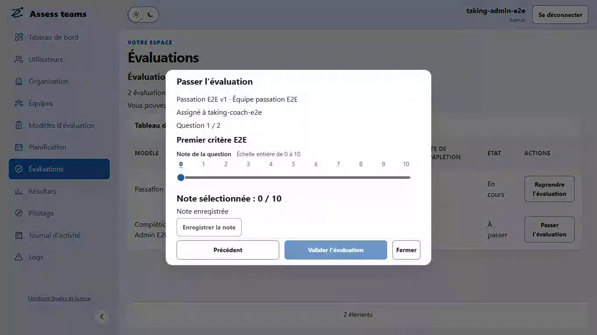
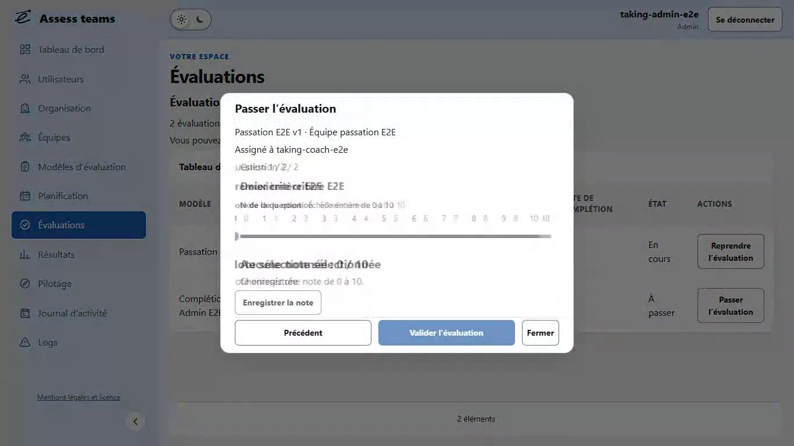
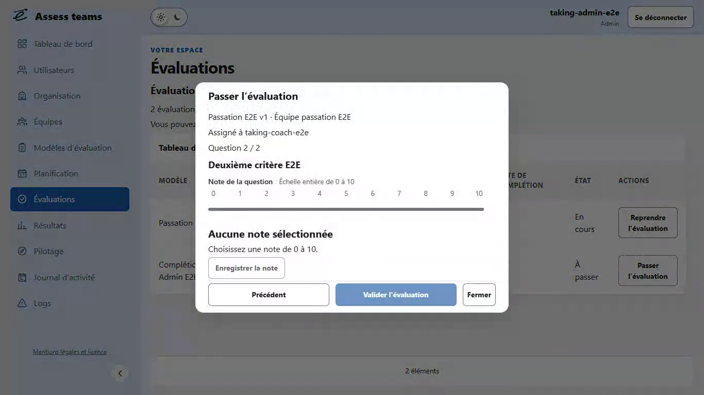

# Recette visuelle du correctif — 2026-10-29

## Preuves à consulter

[Vidéo Chromium à vitesse réelle](continuite-desktop.webm) : 2,72 s, 1366 × 768,
25 images/s, extrait continu du test existant `transitions.spec.ts`.
Aucune animation ralentie, recréée ou figée ; aucun changement de vitesse au montage.
L’extrait montre ouverture, Suivant, Précédent, fermeture, puis
Évaluations → Tableau de bord → Évaluations. Les données sont fictives.

| Début : ancienne question | Milieu : raccord | Fin : nouvelle question |
| --- | --- | --- |
|  |  |  |

Ces images sont décodées dans la même vidéo source, à sa cadence normale.
Les captures correspondent aux frames décodées 16, 20 et 26 du clip (25 images/s) :
ancienne question lisible, chevauchement visible, nouvelle question stabilisée.
Elles ne proviennent pas d’une animation mise en pause artificiellement.
Le milieu montre simultanément les textes des deux questions et leurs notes distinctes.
Le cadre, les métadonnées et les actions ont les mêmes coordonnées dans les trois images.
La nouvelle question est sans note ; le retour retrouve le zéro explicitement sélectionné.

Inspection visuelle par décodage des frames de la vidéo : le contenu précédent reste
présent au début du raccord et s’efface pendant l’arrivée du suivant, sans passage à vide.
Le mouvement horizontal est perceptible ; le retour inverse son sens. Les rubriques
se chevauchent en fondu vertical, en laissant le shell immobile. L’assombrissement
et la surface de dialogue apparaissent et disparaissent progressivement, sans zoom.
Le fichier WebM permet de juger directement cette continuité à vitesse réelle.

## Mesures Chromium réellement rendues

Le sampler existant observe les animations démarrées, puis lit chaque frame rendue
avec `requestAnimationFrame` : transform, opacités entrante/sortante, horloge réelle,
contenus distincts et rectangles fixes. Il n’avance pas l’horloge et ne pilote pas l’animation.
La durée active est celle rapportée par Chromium ; l’intervalle mesuré ci-dessous
commence au premier échantillon visible, donc après les premières millisecondes.

| Format | Surface | Nombre | Durée active ms | Frames | Intervalle mesuré ms | Translation première frame px |
| --- | --- | ---: | ---: | --- | --- | --- |
| 1366 × 768 | Rubrique | 40 | 320 | 20 | 315,3–319,5 | Y +11,92 à +11,93 |
| 1366 × 768 | Question | 59 | 320 | 20 | 316,8–319,4 | X −19,88 à +19,88 |
| 1366 × 768 | Ouverture | 20 | 240 | 15–16 | 230,5–233,9 | Y +8,91 à +9,10 |
| 1366 × 768 | Fermeture | 20 | 220 | 14 | 215,6–217,8 | Y +0,04 à +0,05 |
| 375 × 667 | Rubrique | 40 | 320 | 20 | 311,9–319,4 | Y +11,92 à +11,93 |
| 375 × 667 | Question | 59 | 320 | 20 | 316,0–318,8 | X −19,88 à +19,88 |
| 375 × 667 | Ouverture | 20 | 240 | 15–16 | 231,2–234,1 | Y +8,89 à +8,99 |
| 375 × 667 | Fermeture | 20 | 220 | 14 | 215,7–218,2 | Y +0,04 à +0,05 |

278 transitions au total, dans deux thèmes × dix palettes × deux formats.
Amplitude définie : 20 px pour les questions, 12 px pour rubriques et dialogues.
Les entrées finissent à opacité 1 et translation nulle ; les sorties à opacité 0.
Les deux opacités de contenu sont simultanément positives au milieu et leur somme
reste proche de 1. Les rectangles fixes restent exactement identiques pendant les frames.
Le fond de chaque ouverture prend plusieurs couleurs intermédiaires réellement calculées.
Les JSON complets et vidéos sont joints aux résultats Playwright produits par ces tests.

## Focus, préférences et parcours

- Valeur effective normale : `prefers-reduced-motion: reduce` = **false**, explicitement vérifiée.
- Valeur effective réduite : **true**, aucun événement de transition ; navigation immédiate.
- Changement à chaud pendant une question : copie supprimée immédiatement, focus et note conservés.
- Clics rapides sur questions et rubriques : même objet d’animation, une seule copie sortante,
  dernière destination affichée, sans file d’attente ni redémarrage.
- Clavier : Home/End, Suivant/Précédent avec Entrée, Échap, focus de titre et retour au déclencheur.
- Sauvegarde refusée : aucune sortie trompeuse, fermeture toujours protégée, zéro conservé et réessai possible.
- Révision et finalisation : notes conservées ; fermeture animée seulement après succès ou annulation autorisée.
- Fermeture pendant les premières frames réelles d’ouverture : continuité de position et focus natif conservés.
- Dialogues administratifs : premier champ, erreur interne, saisie conservée et retour du focus.
- Zoom natif Chromium à 200 % : DPR 2, actions atteignables et focus conservé dans les deux thèmes.

Les cinq géométries existantes sont aussi contrôlées : 1366 × 768, 1920 × 1080,
375 × 667, 320 × 568 et 568 × 320. L’action de sauvegarde est désormais incluse
aux égalités exactes avant/après sélection et navigation. Le test de texte très long
garde l’égalité exacte du cadre/pied et des dimensions de l’action ; seul son Y après
un scroll volontaire jusqu’au bout tolère moins de 1 px (arrondi natif, 0,563 px observé).
Cette tolérance ne s’applique jamais aux transitions ni aux changements de question.

Le test React de raccord échoue avec le dialogue initial, faute de rendu sortant,
et passe après correction. Le test existant de géométrie reproduit aussi le saut de
51,156 px de l’action de sauvegarde avant sa stabilisation.
Les douze scénarios ciblés sont validés, dont le scénario long relancé après précision
de l’assertion de scroll volontaire. La livraison exige ensuite les gates globaux,
`npm run publish` et la CI verte du SHA publié, sans modifier leur circuit.

## Corrections issues du passage global

Le test du logo reproduit un débordement réel lors du passage desktop → mobile
pendant le raccord ; le découpage horizontal du viewport le supprime, sans ajouter
de région de scroll. Ses assertions de débordement sont conservées.
Le test de focus reproduit un déplacement de 3,188 px du curseur quand un repère
apparaît : la copie de dimensionnement reflète désormais la structure flex du contenu,
avec question et métadonnées séparées. Les comparaisons exactes restent bloquantes.
Les tests de notation lisent la question courante ; les sélecteurs de formulaire
utilisent le rôle accessible pour exclure les copies inertes. Les assertions de notes,
refus, sauvegardes, droits et provenance restent identiques. Les cinq reproductions
ciblées du passage global passent après ces corrections, sans désactiver les animations.

## Reprise du 2026-10-28

Les 18 parcours ciblant les derniers échecs passent (2,4 min) : refus, échelle,
journaux, Pilotage, droits et gestion des équipes. Les lectures de résultats et
cases à cocher ciblent le contenu courant ou les contrôles accessibles, en excluant
les copies inertes. La position de l’action sticky est mesurée par rapport au corps
visible, sans y ajouter le défilement du document ; les égalités restent exactes.
Le backend complet a validé 1 456 tests, couverture 97,50 %, et le frontend 443 tests,
avec ses quatre seuils respectés. Le pré-push canonique et la CI du SHA publié
restent les conditions finales de livraison ; aucune PR ou règle de publication modifiée.

Le passage canonique a ensuite validé les 109 parcours applicatifs. Le dernier
échec de démonstration venait de la lecture de dates dans la copie sortante ;
le test lit désormais les dates du contenu courant. Les diagnostics Chromium
sont dirigés vers le dossier de rapports existant : sous Windows, `debug.log`
était sinon écrit à côté du binaire installé et modifiait son empreinte pendant
la recette. Les scripts de validation et leurs contrôles restent inchangés.

## Reprise du 2026-10-29

Le second passage complet valide 1 456 tests backend (97,50 %), 443 tests frontend,
109 parcours applicatifs et 10 parcours de démonstration. Le gate détecte encore
une écriture GPU dans `debug.log` du Headless Shell Windows : le simple argument
`--log-file` ne suffisait pas pour cette variante. Le lancement local Windows
utilise désormais le Chromium complet déjà installé, comme le test de zoom natif.
La CI Linux conserve son Headless Shell. Les diagnostics sont explicitement activés
et dirigés vers les rapports existants, sans changer les scripts ni les empreintes.
Six parcours de focus, refus et confirmations répétés passent avec ce lancement ;
le fichier de rapports reçoit réellement les diagnostics GPU et les journaux des
binaires installés restent inchangés. La recette des frames est ensuite revérifiée.

La CI Linux du SHA `eede631` reproduit une régression de compacité : 605,4375 px
sur les deux formats desktop au lieu du plafond existant de 600 px. Le miroir
intrinsèque garde correctement la place des questions et repères, mais la pile
flex réserve davantage d’espace vertical que l’ancien flux. Le padding vertical
desktop passe de 16 à 12 px, valeur déjà utilisée sur mobile ; ni la typographie,
ni la réserve de contenu, ni les assertions de géométrie ne sont réduites.
Le cadre conserve ses dimensions pendant la navigation ; les seuils existants
restent les oracles du correctif, notamment le test Linux déjà en échec.

Les neuf scénarios ciblés passent après correction (3,2 min), dont les cinq formats
et le contenu long, puis les deux matrices de transitions et la réduction des animations.
La vidéo et les trois images sont renouvelées depuis ce rendu corrigé ; les mesures
ci-dessus sont recalculées sur ses 278 transitions réelles. Maximum échantillonné :
19,88 px horizontalement, 11,93 px pour les rubriques et 11,52 px en sortie de dialogue.
